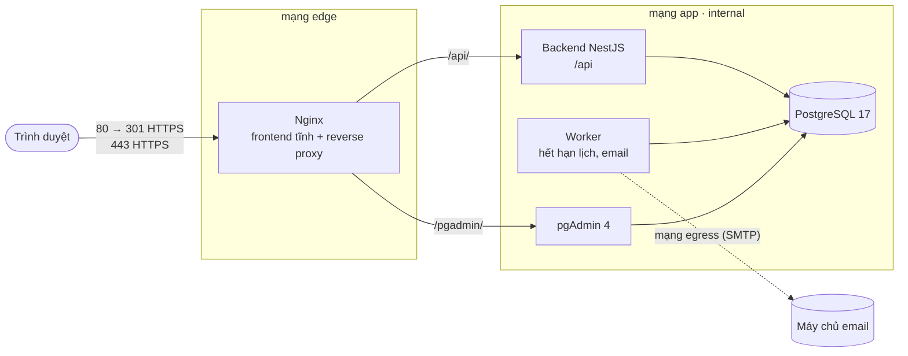

# Hệ thống đặt lịch hẹn – An Nhiên Studio

Website đặt lịch hẹn (dịch vụ, khung giờ, khách hàng, xác nhận) triển khai bằng **Docker Compose**: React + NestJS + PostgreSQL + pgAdmin, đứng sau **Nginx reverse proxy** có HTTPS tự ký và security headers.

> Đề 40 – Học phần Triển khai và Quản trị Hệ thống Phần mềm.
> Trạng thái: **commit 1** (ứng dụng, cơ sở dữ liệu, pgAdmin, Nginx HTTPS, hardening cơ bản). Giám sát Prometheus + Grafana (commit 2) và log tập trung Loki + Promtail (commit 3) sẽ được bổ sung.

## Kiến trúc



- Chỉ **Nginx** publish cổng (80, 443). PostgreSQL, pgAdmin, backend nằm trong mạng `app` (internal), không truy cập trực tiếp từ máy chủ.
- Frontend được build thành tệp tĩnh và đóng gói cùng image Nginx.
- Chống đặt trùng bằng **exclusion constraint** của PostgreSQL (`btree_gist` + `tstzrange`): hai lịch cùng nhân viên không thể chồng giờ kể cả khi gửi đồng thời.

| Thành phần | Công nghệ |
| --- | --- |
| Frontend | React 19, TypeScript, Vite, Tailwind CSS |
| Backend, worker | Node.js 22, NestJS 11, `pg` (SQL migration thuần) |
| Cơ sở dữ liệu | PostgreSQL 17 + pgAdmin 4 |
| Reverse proxy | Nginx 1.28 (image `nginx-unprivileged`) |
| Triển khai | Docker Compose |

## Yêu cầu

- Docker Desktop (Windows/macOS) hoặc Docker Engine + Docker Compose v2 (Linux), tối thiểu 4 GB RAM.
- `openssl` và `bash` để chạy script (Windows: dùng **Git Bash** đi kèm Git for Windows).
- Cổng 80 và 443 trên máy còn trống.

## Chạy hệ thống

```bash
git clone https://github.com/VPhuong06/DTC245200722.git && cd DTC245200722
./scripts/gen-env.sh          # tạo .env với mật khẩu ngẫu nhiên mạnh (hoặc: cp .env.example .env rồi sửa mọi CHANGE_ME)
./scripts/gen-cert.sh         # sinh chứng chỉ HTTPS tự ký vào nginx/certs/
docker compose up -d --build
docker compose ps             # mọi dịch vụ ở trạng thái running / healthy
```

Mở `https://localhost`. Trình duyệt sẽ cảnh báo vì chứng chỉ tự ký: chọn *Nâng cao → Tiếp tục*.

Dừng hệ thống: `docker compose down` (giữ dữ liệu) hoặc `docker compose down -v` (xóa cả volume dữ liệu).

### Địa chỉ truy cập

| Dịch vụ | Địa chỉ |
| --- | --- |
| Website đặt lịch (khách) | `https://localhost` |
| Tra cứu, đổi, hủy lịch (khách) | `https://localhost/tra-cuu` |
| Trang quản trị | `https://localhost/quan-tri` |
| API | `https://localhost/api/v1` |
| Tài liệu API (Swagger/OpenAPI) | `https://localhost/api/docs` |
| pgAdmin | `https://localhost/pgadmin/` |

### Tài khoản demo

Mọi mật khẩu nằm trong tệp `.env` (không commit):

| Ứng dụng | Tài khoản | Mật khẩu |
| --- | --- | --- |
| Trang quản trị | `ADMIN_EMAIL` | `ADMIN_PASSWORD` |
| pgAdmin | `PGADMIN_DEFAULT_EMAIL` | `PGADMIN_DEFAULT_PASSWORD` |
| Kết nối PostgreSQL trong pgAdmin (khai báo sẵn "Booking PostgreSQL") | `booking_app` | `APP_DB_PASSWORD` |

Khi `SEED_DEMO=true` và cơ sở dữ liệu còn trống, hệ thống nạp dữ liệu mẫu: 4 dịch vụ, 3 nhân viên (làm Thứ Hai – Thứ Bảy, 09:00–17:00) và 15 lịch hẹn quanh ngày hiện tại.

## Chức năng

**Khách (không cần đăng nhập):** chọn dịch vụ, nhân viên hoặc "Nhân viên bất kỳ", chọn ngày và giờ còn trống, nhập thông tin và đồng ý chính sách quyền riêng tư, nhận **mã lịch** (LH…) và **mã tra cứu**. Tra cứu bằng mã tra cứu + số điện thoại để tự đổi hoặc hủy lịch trước hạn.

**Quản trị viên:** xem lịch theo **danh sách / ngày / tuần**, tìm kiếm và lọc theo dịch vụ, nhân viên, trạng thái; tạo lịch hộ khách gọi điện; xác nhận, đổi, hủy (kèm lý do), đánh dấu hoàn thành hoặc khách không đến; xem lịch sử thao tác. Quản lý dịch vụ, nhân viên và giờ làm, ngày nghỉ, nghỉ phép, chính sách đặt lịch, khách hàng.

**Vòng đời lịch:** Chờ xác nhận → Đã xác nhận → Hoàn thành / Không đến. Lịch chờ hoặc đã xác nhận có thể bị hủy; lịch chờ quá thời gian giữ chỗ tự chuyển sang Hết hạn (worker). Chỉ lịch Chờ xác nhận và Đã xác nhận chiếm giờ của nhân viên.

**Quy tắc chống đặt trùng:**

- Frontend chỉ hiển thị giờ trống; backend kiểm tra lại toàn bộ (giờ làm, thời lượng + thời gian chuẩn bị, ngày nghỉ, đặt trước tối thiểu/tối đa).
- Ràng buộc `no_overlap_per_staff` trong PostgreSQL là chốt chặn cuối; vi phạm → API trả `409 Conflict` với thông báo như "Minh Lan đã có lịch 15:00–16:00. Chọn giờ hoặc nhân viên khác."
- Tạo lịch bắt buộc header `Idempotency-Key`: gửi lại cùng key trả lại kết quả cũ, không tạo lịch mới.
- Đổi lịch chạy trong một giao dịch; thất bại thì lịch cũ giữ nguyên.

Lỗi API luôn có dạng `{ "error": { "code", "message", "request_id" } }`.

## Hardening

| Biện pháp | Cách làm | Lệnh kiểm chứng |
| --- | --- | --- |
| Container non-root | Backend/worker chạy `USER node`; Nginx dùng `nginxinc/nginx-unprivileged` (cổng 8080/8443 bên trong); pgAdmin chạy bằng uid 5050 | `docker compose exec backend id` → `uid=1000(node)` |
| Tách mạng | `edge`: chỉ Nginx publish 80/443. `app` (internal): backend, worker, PostgreSQL, pgAdmin. `egress`: chỉ worker (gửi email). PostgreSQL không publish cổng | `docker network inspect booking_app`; `Test-NetConnection localhost -Port 5432` (Windows) hoặc `nc -zv localhost 5432` → thất bại |
| Mật khẩu mạnh, bí mật | pgAdmin tắt Gravatar (không gửi mã băm email quản trị ra ngoài) và kiểm tra phiên bản qua Internet; `scripts/gen-env.sh` sinh mật khẩu ngẫu nhiên 24 ký tự (JWT 48 ký tự); `.env` và khóa riêng TLS nằm trong `.gitignore` | `git log --all -- .env` không có kết quả |
| Hạn chế quyền DB | `booking_app` không SUPERUSER, chỉ sở hữu schema `app`; `exporter` chỉ có `pg_monitor`; thu hồi quyền mặc định của PUBLIC | `docker compose exec postgres psql -U postgres -d booking -c '\du'` |
| Giới hạn quyền container | `no-new-privileges` cho mọi dịch vụ; `cap_drop: [ALL]`, `read_only: true` + `tmpfs` cho Nginx/backend/worker; PostgreSQL chỉ giữ 5 capability cần cho entrypoint; pgAdmin chỉ giữ `NET_BIND_SERVICE` (tệp python của image có file capability này); giới hạn CPU/RAM từng dịch vụ | `docker inspect booking-backend-1 --format '{{.HostConfig.CapDrop}} {{.HostConfig.ReadonlyRootfs}} {{.HostConfig.SecurityOpt}}'` |
| Security headers, HTTPS | TLS 1.2/1.3, HSTS, CSP, X-Frame-Options, X-Content-Type-Options, Referrer-Policy, Permissions-Policy; `server_tokens off`; HTTP 80 → 301 HTTPS | `curl -kI https://localhost`; `curl -I http://localhost` |
| Giới hạn tốc độ | Nginx `limit_req` cho `/api/` (20 req/s) và đăng nhập (5 req/phút) trả 429; ứng dụng giới hạn thêm đăng nhập, tra cứu, đặt lịch; khóa tài khoản 15 phút sau 5 lần sai | Xem lệnh bên dưới |
| Ứng dụng | Mật khẩu băm bcrypt; cookie phiên `HttpOnly`, `Secure`, `SameSite=Strict`; chống CSRF bằng header bắt buộc; kiểm tra quyền trên mọi API quản trị; mã tra cứu ngẫu nhiên và luôn cần kèm số điện thoại; log không ghi số điện thoại, email, query string | `curl -k https://localhost/api/v1/admin/appointments?from=2026-01-01&to=2026-01-01` → 401 |
| Image cố định phiên bản | `node:22.22-alpine`, `nginxinc/nginx-unprivileged:1.28-alpine`, `postgres:17.6-alpine`, `dpage/pgadmin4:9.8` (không dùng `latest`) | `docker compose config --images` |

Thử giới hạn tốc độ đăng nhập (Git Bash):

```bash
for i in $(seq 1 12); do curl -sk -o /dev/null -w "%{http_code} " -X POST https://localhost/api/v1/auth/login -H 'Content-Type: application/json' -d '{"email":"x@annhien.vn","password":"sai"}'; done; echo
# Kết quả: vài mã 401 rồi 429
```

## Ảnh minh chứng

Ảnh chụp từ hệ thống đang chạy thật (`docs/images/`). Ảnh kết quả lệnh giữ nguyên văn đầu ra, chỉ tô màu dòng lệnh và chú thích.

### Ứng dụng và cơ sở dữ liệu

| | |
| --- | --- |
|  Khách chọn dịch vụ, nhân viên |  Chỉ hiển thị giờ còn trống |
|  Nhận mã lịch và mã tra cứu |  Tra cứu bằng mã + số điện thoại, tự đổi/hủy |
|  Quản trị: danh sách, lọc, chi tiết |  Quản trị: lịch theo tuần |
|  pgAdmin kết nối bằng `booking_app`, 15 bảng của schema `app` |  Truy vấn dữ liệu trong pgAdmin |
|  Tài liệu API (OpenAPI) |  User DB `booking_app` không phải superuser |

### Nginx reverse proxy, HTTPS


## Kiểm thử

```bash
# Unit test (tính giờ trống, định dạng thời gian)
cd backend && npm ci && npm test
cd frontend && npm ci && npm test

# Kiểm thử API trên hệ thống đang chạy (38 kiểm tra): đặt lịch, trùng giờ, idempotency,
# 10 yêu cầu đặt cùng lúc chỉ 1 thành công, tra cứu, phân quyền, CSRF.
# Đặt RATE_LIMIT_MULTIPLIER=10 trong .env rồi docker compose up -d trước khi chạy.
ADMIN_EMAIL=... ADMIN_PASSWORD=... node scripts/smoke-test.mjs
```

## Phát triển cục bộ (không dùng Docker)

Cần PostgreSQL có sẵn user/schema như `postgres/init/01-roles.sh`.

```bash
cd backend && npm ci && npm run build
DB_HOST=localhost DB_NAME=booking DB_USER=booking_app DB_PASSWORD=... \
JWT_SECRET=<chuỗi ≥ 32 ký tự> COOKIE_SECURE=false ADMIN_EMAIL=... ADMIN_PASSWORD=... node dist/main.js

cd frontend && npm ci && npm run dev   # http://localhost:5173, /api được proxy sang :3000
```

## Cấu trúc thư mục

```text
.
├── backend/                 # NestJS: API, worker, migration SQL, Dockerfile (non-root)
├── frontend/                # React + Vite; Dockerfile build tệp tĩnh vào image Nginx
├── nginx/
│   ├── nginx.conf           # log JSON, limit_req, server_tokens off
│   ├── conf.d/booking.conf  # 80→443, HTTPS, định tuyến /, /api/, /pgadmin/, stub_status
│   ├── snippets/            # security headers, proxy tới backend
│   └── certs/               # sinh bằng scripts/gen-cert.sh, không commit
├── postgres/init/           # tạo user ứng dụng và user exporter quyền hạn chế
├── pgadmin/servers.json     # khai báo sẵn kết nối PostgreSQL
├── scripts/                 # gen-env.sh, gen-cert.sh, smoke-test.mjs
├── docs/images/             # ảnh minh chứng (xem mục "Ảnh minh chứng")
├── docker-compose.yml
└── .env.example             # mẫu biến môi trường, không chứa mật khẩu thật
```

## Ghi chú cho Windows

- Chạy các script `.sh` trong **Git Bash**. Repository dùng `.gitattributes` để giữ xuống dòng LF cho tệp chạy trong container.
- Nếu cổng 80/443 đã bị chiếm, đổi `HTTP_PORT`/`HTTPS_PORT` trong `.env`. Khi đổi cổng HTTPS, truy cập trực tiếp `https://localhost:<cổng>` (chuyển hướng từ HTTP luôn trỏ về cổng 443).
